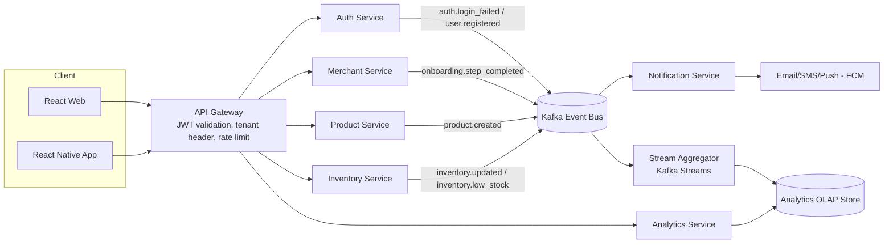
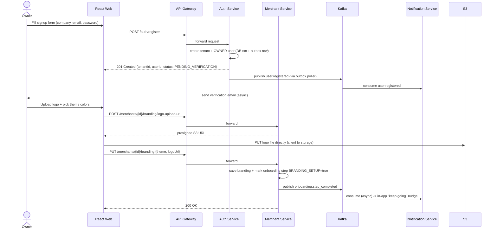
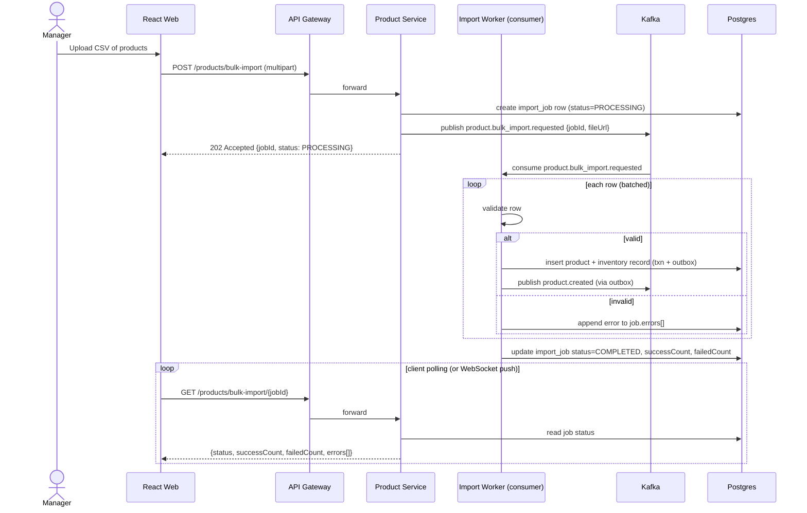
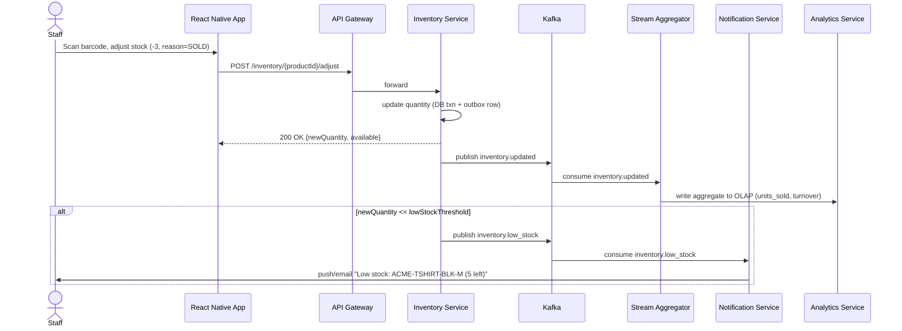
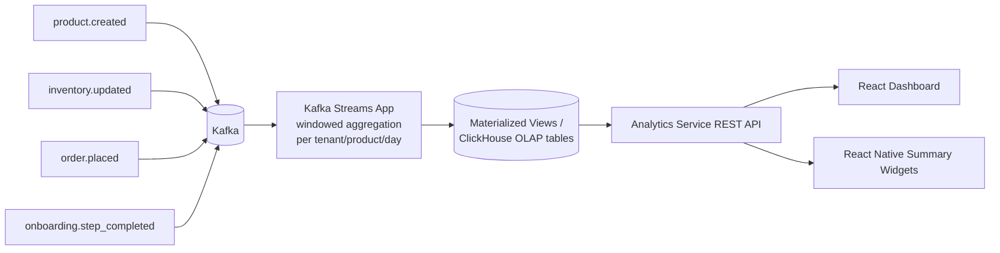
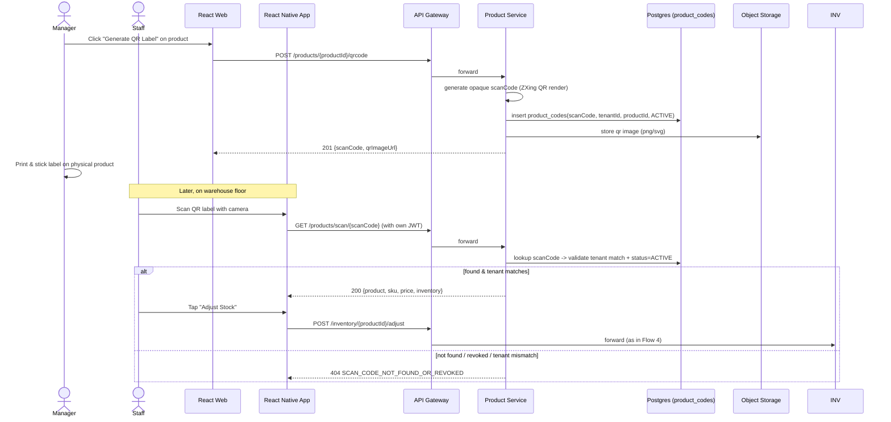
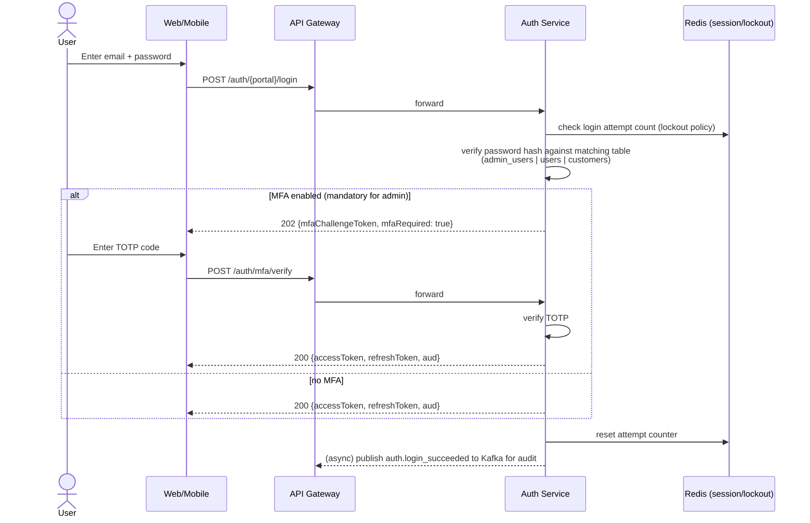
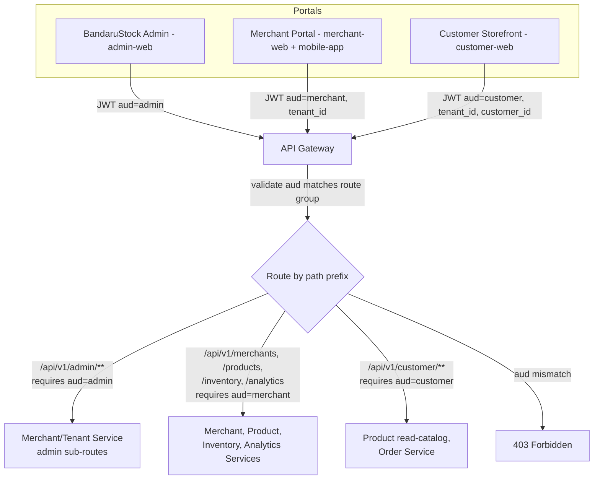

# Flow Diagrams

## 1. High-Level Microservice + Async Flow (overview)

---
## 2. Merchant Onboarding Flow (sync signup + async setup)

---
## 3. Product Onboarding — Bulk Import (async job pattern)

---
## 4. Inventory Update → Low-Stock Alert (event-driven)

---
## 5. Analytics Aggregation Pipeline (continuous async)

---
## 6. QR Code Label — Generate & Scan Flow

**Bulk label printing (async job)** follows the same async job pattern as CSV bulk import: `POST /products/qrcodes/bulk-print` → `202 {jobId}` → worker renders a multi-label PDF sheet → client polls `GET /products/qrcodes/bulk-print/{jobId}` for the final `pdfUrl` to print and cut out labels.

---
## 7. Login / Auth Flow (sync, with optional MFA)

---
## 8. Three Portals — Gateway Audience Routing

